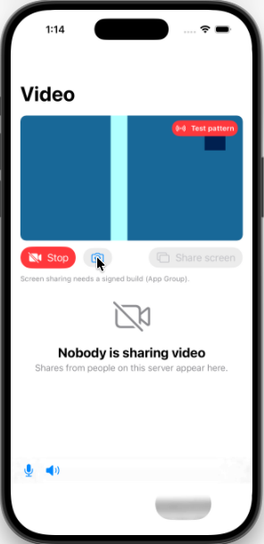

# Mumble Video for iOS

Native iOS client for [Mumble Video](https://github.com/Calegix-net/mumble-video): voice, chat and video.
The protocol, crypto and media transport come from the same `mumble-core` the desktop and Android clients
use; the app adds TLS, audio, codecs and a SwiftUI interface.

## Layout

- `Vendor/mumble-core`: `mumble-core` from the desktop repo, vendored by `tools/sync-core.sh` (see
  `CORE_REVISION`).
- `tools/build-deps.sh`: builds OpenSSL libcrypto, Abseil + protobuf-lite, Opus, libvpx and mumble-core
  for iPhone plus this Mac's simulator and macOS architecture, and packages them as `Frameworks/MumbleNative.xcframework`.
  Pins are in `tools/versions.sh` (OpenSSL, Protobuf, Abseil and Opus match the Android client).
- `Sources/CMumbleBridge`: a small C surface over mumble-core, Opus and libvpx, so Swift imports it as-is.
- `Sources/MumbleKit`: the Swift client core, including `VideoSender` (camera VP8, pre-encoded H.264,
  stream ids, keyframe requests) and the resend history that answers viewers' VideoNacks.
- `Sources/MumbleShare`: screen sharing's half that runs in the broadcast extension: hardware H.264 through
  VideoToolbox and the App Group socket to the app. Apple frameworks only.
- `App/`: the SwiftUI app (`project.yml`; `tools/gen-project.sh` generates `MumbleVideo.xcodeproj`).
- `Broadcast/`: the ReplayKit broadcast upload extension that shares the screen.
- `Sources/mv-test-peer`: a scripted peer that joins a server, speaks a tone and streams a VP8 test
  pattern, so there is someone to hear and something to watch.

Voice, chat, watching video, and sending the camera (VP8, which every Mumble Video client decodes) and
the screen (H.264 from the broadcast extension). Where there is no camera, as in the Simulator, the camera
button sends a moving test pattern instead. Screen sharing needs the App Group
`group.com.calegix.mumblevideo`, so it only works in a signed build on a device.

  

## Installing

Each release has an unsigned `MumbleVideo.ipa` to sideload with Sideloadly or AltStore:
[docs/SIDELOAD.md](docs/SIDELOAD.md). CI (`.github/workflows/ios.yml`) builds and tests every push. Pushing
a `v*` tag publishes a release.

## Building

On a Mac with Xcode 26 (Intel or Apple Silicon; Xcode 27 is Apple Silicon only):

```sh
pip3 install --user cmake ninja
tools/build-deps.sh
swift test          # MumbleKit on macOS
MUMBLE_TEST_SERVER=host:port swift test    # plus the live tests: connect, voice, and video both ways
# watch someone's stream (the app in the Simulator, a phone) and save the last picture:
MUMBLE_TEST_SERVER=host:port MUMBLE_WATCH_USER=name MUMBLE_WATCH_PNG=/tmp/x.png swift test --filter watchesAUser
tools/gen-project.sh && open MumbleVideo.xcodeproj
tools/package-ipa.sh   # build/MumbleVideo.ipa, as CI makes it
```
