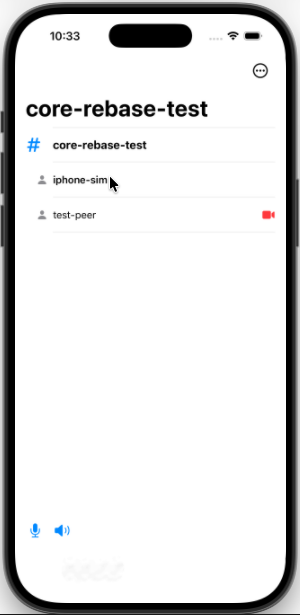
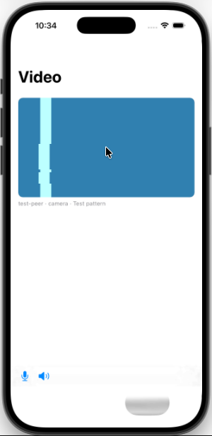

# Mumble Video for iOS

Native iOS client for [Mumble Video](https://github.com/Calegix-net/mumble-video): voice, chat and video.
The protocol, crypto and media transport come from the same `mumble-core` the desktop and Android clients
use; the app adds TLS, audio, codecs and a SwiftUI interface.

## Layout

- `Vendor/mumble-core`: `mumble-core` from the desktop repo, vendored by `tools/sync-core.sh` (see
  `CORE_REVISION`).
- `tools/build-deps.sh`: builds OpenSSL libcrypto, Abseil + protobuf-lite, Opus, libvpx and mumble-core
  for iPhone, the Intel simulator and macOS, and packages them as `Frameworks/MumbleNative.xcframework`.
  Pins are in `tools/versions.sh` (OpenSSL, Protobuf, Abseil and Opus match the Android client).
- `Sources/CMumbleBridge`: a small C surface over mumble-core, Opus and libvpx, so Swift imports it as-is.
- `Sources/MumbleKit`: the Swift client core.

- `App/`: the SwiftUI app (`project.yml`; `tools/gen-project.sh` generates `MumbleVideo.xcodeproj`).
- `Sources/mv-test-peer`: a scripted peer that joins a server, speaks a tone and streams a VP8 test
  pattern, so there is someone to hear and something to watch.

The first version does voice, chat and watching video; sending camera and screen comes next.

 

## Building

On a Mac with Xcode 26 (the last release that runs on Intel):

```sh
pip3 install --user cmake ninja
tools/build-deps.sh
swift test          # MumbleKit on macOS
MUMBLE_TEST_SERVER=host:port swift test    # plus the live tests: connect, voice and video end to end
tools/gen-project.sh && open MumbleVideo.xcodeproj
```
